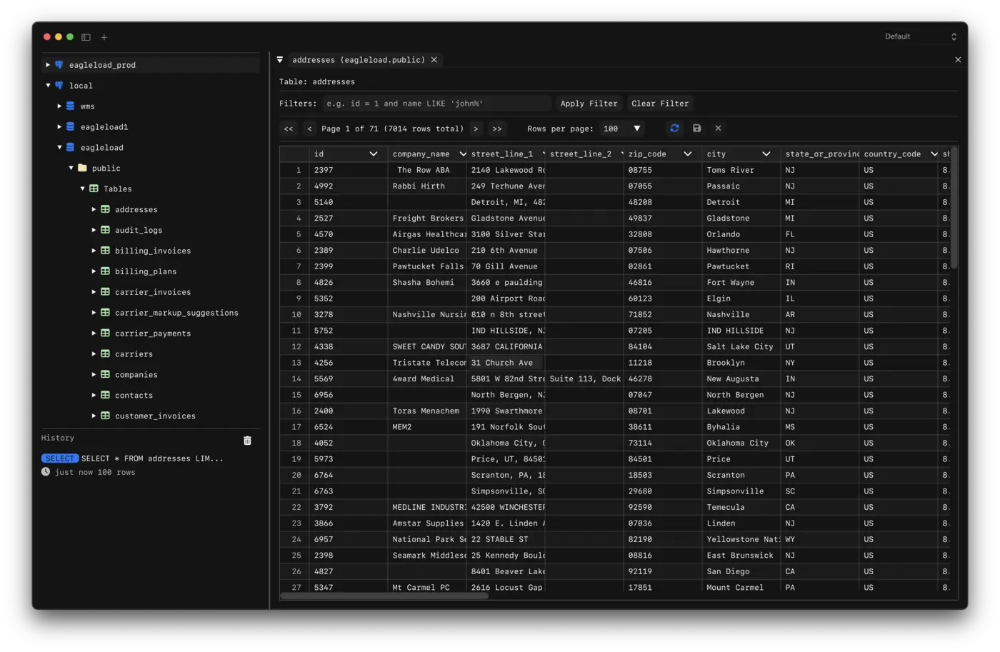
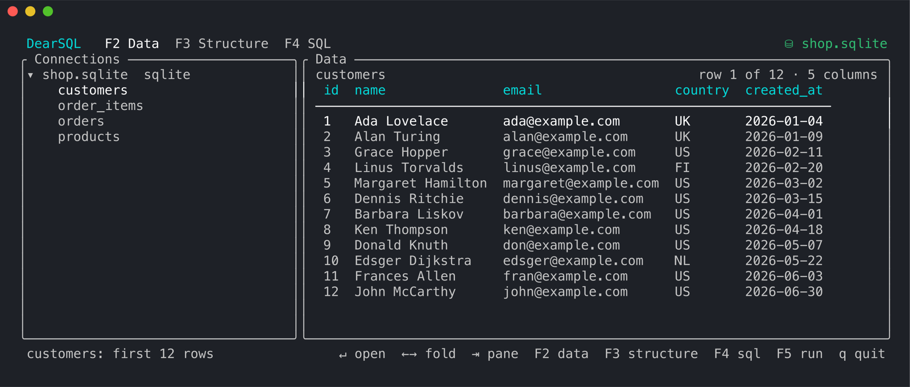

<p align="center">
  
</p>

<h1 align="center">DearSQL</h1>

<p align="center">A simple, cross-platform database client built with Dear ImGui.</p>

<p align="center">
  <a href="https://dearsql.dev/">Download</a>
</p>

<p align="center">
  <a href="https://github.com/dunkbing/dearsql/releases"></a>
</p>



## Features

- SQLite, DuckDB, PostgreSQL, MySQL, MariaDB, SQL Server, Oracle, MongoDB, Redis and more
- Cross-platform: macOS (Metal), Linux (GTK4 + OpenGL), Windows (DirectX 11)
- Database browser: Sidebar for exploring schemas, tables, and structure
- Native file dialogs for SQLite files
- Native alert/confirm dialogs per platform
- Saves and restores previous database connections
- Run SQL queries with formatted results display
- Query history

## Command line

The same binary runs in the terminal ([docs](https://dearsql.dev/docs/command-line)):

```sh
dearsql --tui [connection]   # browse and query in the terminal
dearsql --mcp                # database tools for coding agents (MCP)
dearsql --lsp                # SQL completion and hover for editors
```



A connection is a saved name, a URL, or a SQLite/DuckDB/CSV file. For agents:

```sh
claude mcp add dearsql -- dearsql --mcp
```

## Installation

Download the latest release for macOS, Linux, and Windows from [GitHub Releases](https://github.com/dunkbing/dearsql/releases), or on macOS/Linux:

```sh
curl -fsSL https://dearsql.dev/install.sh | sh
```

### Arch Linux ([AUR](https://aur.archlinux.org/packages/dearsql))

```sh
yay -S dearsql
# or
paru -S dearsql
```
## Build instructions

```sh
claude "build this project"
```

## Built With

- [Dear ImGui](https://github.com/ocornut/imgui) - Immediate mode GUI
- [Native File Dialog](https://github.com/btzy/nativefiledialog-extended) - File pickers
- [IconFontCppHeaders](https://github.com/juliettef/IconFontCppHeaders) - Icon fonts
- [vcpkg.json](vcpkg.json) - Full dependency list
