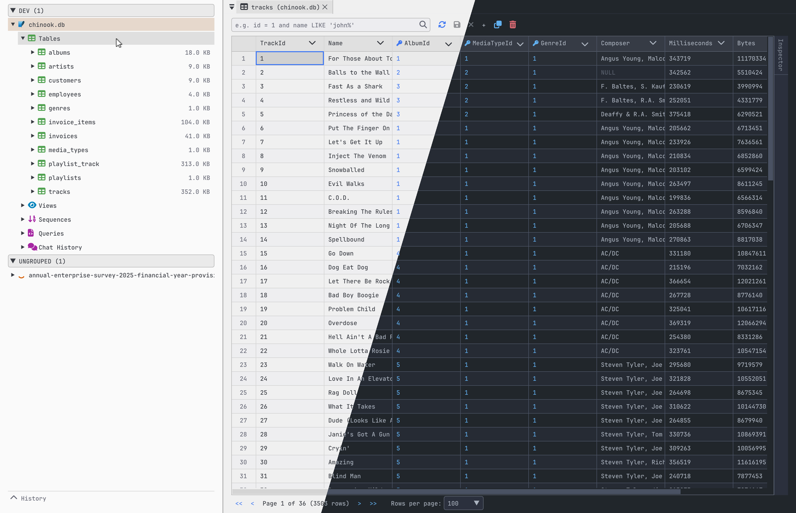
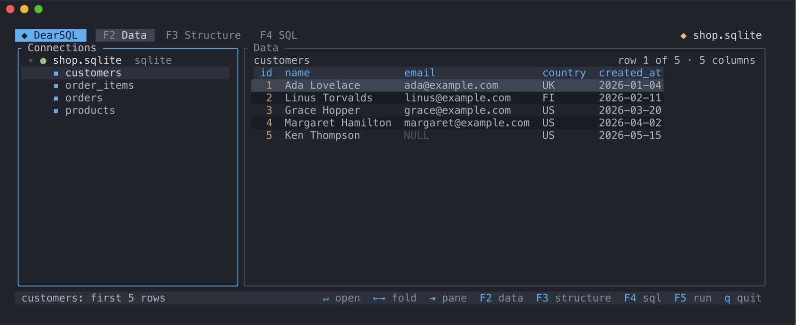

<p align="center">
  
</p>

<h1 align="center">DearSQL</h1>

<p align="center">A simple, cross-platform database client built with Dear ImGui.</p>

<p align="center">
  <a href="https://dearsql.dev/">Download</a>
</p>

<p align="center">
  <a href="https://github.com/dunkbing/dearsql/releases"></a>
</p>



## Features

- SQLite, DuckDB, PostgreSQL, MySQL, MariaDB, SQL Server, Oracle, MongoDB, Redis, Cassandra and more, plus S3-compatible object storage
- Cross-platform: macOS (Metal), Linux (GTK4 + OpenGL), Windows (DirectX 11)
- Schema browser, editable data grid, SQL editor with completion and syntax checks, charts, JSON view
- Query plans (Explain / Analyze) with warnings for full scans, repeated scans, big sorts and bad estimates
- AI agents in the app (Claude Code, Codex, Gemini CLI, Cursor) that read your schema and run queries, writing only after you approve
- Terminal client, MCP server and language server from the same binary

## Command line

The same binary runs in the terminal ([docs](https://dearsql.dev/docs/command-line)):

```sh
dearsql --tui [connection]   # browse and query in the terminal
dearsql --mcp                # database tools for coding agents (MCP)
dearsql --lsp                # SQL completion and hover for editors
dearsql query "SELECT ..."   # the same tools as commands: search, describe, query, ...
```



A connection is a saved name, a URL, or a SQLite/DuckDB/CSV file.

## For coding agents

DearSQL gives an agent your saved connections (credentials stay encrypted in DearSQL, SSH tunnels included) as tools, with compact text results ([docs](https://dearsql.dev/docs/ai-database-tools)):

| Tool | |
|---|---|
| `search_schema`, `describe_table`, `list_tables` | find tables and columns (fuzzy, typo-tolerant), then keys, indexes and foreign keys |
| `run_query` | one read-only statement, paged with a cursor |
| `explain_query` | the query plan plus warnings: full scans a filter mostly discards, scans repeated per join row, spilled sorts, bad estimates |
| `review_indexes` | foreign keys with no index, indexes another one covers |
| `explain_finding` | what a warning code means, how to confirm it, the usual fix |
| `profile_table` | per column: nulls, distinct values, min and max, the common values |
| `diff_schema` | the statements that would make one database's schema match another's |
| `execute_sql` | a change, approved by you first (`--allow-writes` over MCP) |
| `list_objects`, `read_object`, ... | S3 buckets and files |

The `dearsql` command has to be on your PATH: **Settings → Command Line → Install 'dearsql' Command** in the app, or the install script below.

**Claude Code**: the plugin registers the MCP server and adds a skill that teaches the workflow (search before writing SQL, explain before suggesting an index, approve every write):

```
/plugin install dearsql --marketplace dunkbing/dearsql
```

or only the MCP server: `claude mcp add dearsql -- dearsql --mcp`.

**Codex**: register the server and add the skill to `~/.agents/skills`:

```sh
codex mcp add dearsql -- dearsql --mcp
mkdir -p ~/.agents/skills/dearsql && curl -fsSL https://raw.githubusercontent.com/dunkbing/dearsql/main/plugins/dearsql/skills/dearsql/SKILL.md -o ~/.agents/skills/dearsql/SKILL.md
```

**Anything else**: any MCP client can run `dearsql --mcp` over stdio, and an agent with a shell can use the same tools as commands (`dearsql tools` lists them). The skill in [`plugins/dearsql/skills/dearsql/SKILL.md`](plugins/dearsql/skills/dearsql/SKILL.md) works as a prompt for any of them.

## Installation

Download the latest release for macOS, Linux, and Windows from [GitHub Releases](https://github.com/dunkbing/dearsql/releases), or on macOS/Linux:

```sh
curl -fsSL https://dearsql.dev/install.sh | sh
```

### Arch Linux ([AUR](https://aur.archlinux.org/packages/dearsql))

```sh
yay -S dearsql
# or
paru -S dearsql
```
## Build instructions

```sh
./scripts/build
# or
claude "build this project"
```

## Built With

- [Dear ImGui](https://github.com/ocornut/imgui) - Immediate mode GUI
- [Native File Dialog](https://github.com/btzy/nativefiledialog-extended) - File pickers
- [IconFontCppHeaders](https://github.com/juliettef/IconFontCppHeaders) - Icon fonts
- [vcpkg.json](vcpkg.json) - Full dependency list
